# Vulix ダッシュボード利用ガイド

このガイドでは、Vulix（旧称 WScan）の Server Portal から設定画面を開き、通常・Agent・Hybrid の各モードで検査を開始し、実行状況と結果を確認する手順を説明します。

ダッシュボード（`python3 main.py serve`）が WScan の基本の操作面です。検査の起動、機能フラグの切り替え、進捗確認、結果閲覧までここで完結します（CLI は自動化・CI 向けの補助入口）。

実行中にブラウザを再読み込みしたり WebSocket が再接続した場合、画面はサーバーが保持する最新のスキャン状態・結果・カウンターから復元されます。

スクリーンショットはローカルの疑似脆弱アプリに対する実行例です。実際の画面では対象や検出内容が異なります。

> WScan は脆弱性検査ツールです。自分が管理している環境、または検査許可を得た環境だけを対象にしてください。最初はステージング環境と小さいスコープで負荷・副作用を確認してください。

## 1. 3モードを選ぶ

WScan は、モードごとに優先する品質が異なります。

| モード | 画面の入口 | 優先するもの | 結果の読み方 |
| --- | --- | --- | --- |
| 通常 | 設定画面下部の「スキャン開始」 | 確実性 | 決定論スキャナの Finding。`verified`、`confidence`、Evidence を確認 |
| Agent | 「Agent Browser」タブ | 独自性 | LLM の独自解釈。HTML レポートで `🤖 Agent発見` バッジを確認 |
| Hybrid | 「ハイブリッド」タブ | 確実性と独自性の中間 | 通常 Finding と Agent Finding を出自ラベル付きで併記 |

通常モードは定期診断や再検査、Agent は複雑な導線の探索、Hybrid は SPA や認証後画面を広く探しながら決定論スキャンも実施したい場合に向いています。

## 2. 事前準備

本体と Playwright Chromium をインストールします。

```bash
git clone https://github.com/oudontabetai1-lab/AutoXSScheckTool.git
cd AutoXSScheckTool
python3 -m pip install -r requirements.txt
playwright install chromium
```

Agent または Hybrid を使う場合は追加依存を入れます。

```bash
python3 -m pip install -r requirements-agent.txt
```

利用する LLM に合わせて API キーまたは Ollama を準備します。ダッシュボードの Agent/Hybrid タブで選択できる provider は Claude、OpenAI、Ollama です。

```bash
# Claude の例
export ANTHROPIC_API_KEY="<api-key>"
```

Python 3.11 以上を推奨します。

## 3. ダッシュボードを起動する

ローカル限定で起動する例:

```bash
python3 main.py serve --host 127.0.0.1 --port 8765
```

ブラウザで次を開きます。

```text
http://localhost:8765/
```

`/` はスキャン履歴、現在の実行、定期スキャンを扱う Server Portal です。画面上の対象 URL（スキャン一覧・実行中バナー・差分・定期スキャン）は `/monitor` と同様に表示時のみ資格情報（query/fragment/matrix/cookieless session）を伏せ、HTTP(S) として解釈できない値や曖昧な入力は中立のプレースホルダ（`（URL非表示）`）で表示して画面共有時の漏えいを防ぎます（保存済みの設定やスキャン入力は変更しません）。「新規スキャン」を押すと `/monitor` の設定画面へ移動します。直接 `http://localhost:8765/monitor` を開いても構いません。

イントラネットから利用する場合は、認証トークンを設定してください。

```bash
export WSCAN_AUTH_TOKEN="<long-random-token>"
python3 main.py serve --host 0.0.0.0 --port 8765
```

ポートが使用中なら `--port 8766` のように変更します。

## 4. 初期設定画面を確認する

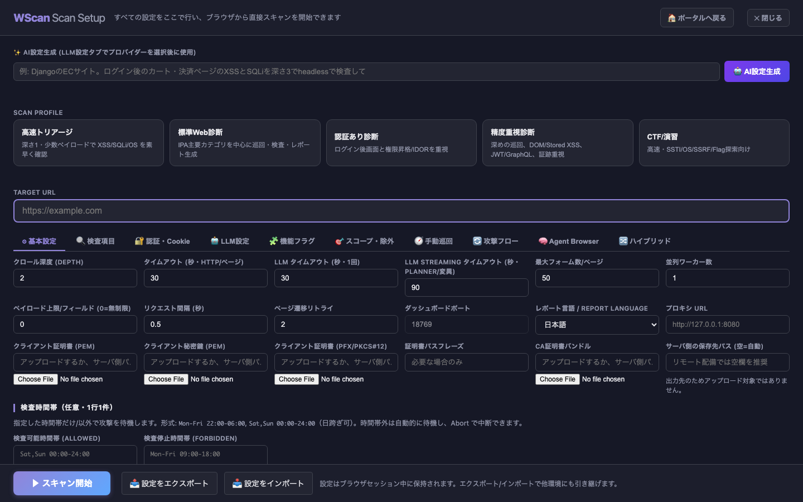

画面上部には Target URL、スキャンプロファイル、設定タブがあります。通常スキャンを始める前に、少なくとも次を確認します。

1. Target URL が許可済みの検査対象である。
2. 削除、決済、送信、ログアウトなど副作用のある URL を除外した。
3. 認証や外部 IdP の範囲を「攻撃対象」と「アクセスのみ許可」に分けた。
4. リクエスト間隔と並列数が対象の許容負荷に収まる。

## 5. 通常スキャンの設定を入力する

Target URL を入力し、目的に近いプロファイルを選びます。

| プロファイル | 用途 |
| --- | --- |
| 高速トリアージ | 深さ1・少数ペイロードで XSS/SQLi/OS を短時間確認 |
| 標準Web診断 | IPA 主要カテゴリを中心に巡回・検査 |
| 認証あり診断 | ログイン後画面、権限昇格、IDOR を重視 |
| 精度重視診断 | 深い巡回、DOM/Stored XSS、JWT/GraphQL、証跡を重視 |
| CTF/演習 | SSTI、OS、SSRF、Flag 探索を重視 |

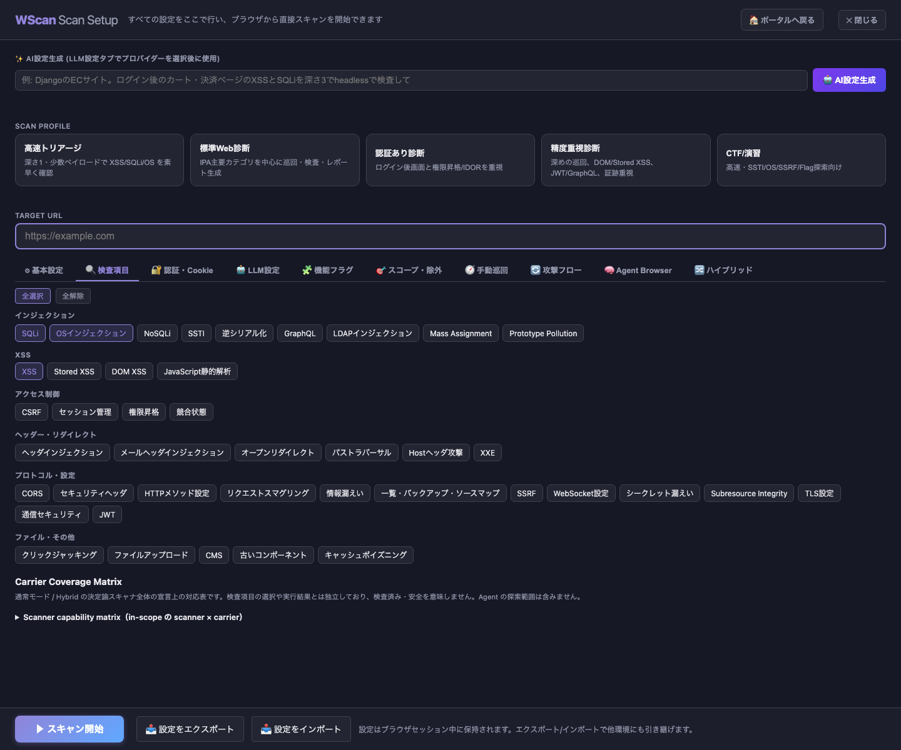

「検査項目」タブでは、SCANNERS レジストリに登録された全 check をカテゴリ別に選択できます。既定で有効なのは SQLi・OS インジェクション・XSS です。

### 入力経路ごとの対応を確認する

「検査項目」タブ下部の **Carrier Coverage Matrix** 内の対応表を開くと、report と共通の宣言データで scanner × carrier（query / form / json 等）を確認できます。通常モードと Hybrid の決定論スキャナ全体が対象で、チェック選択によらず全行を表示します。Agent の自律探索は含みません。

- `s`（緑）: 宣言上の対応。E2E 未接続であり、今回実行済みという意味ではありません。
- `P`（黄）: 実装予定。`U`（灰）: 非対応。`?`（赤）: 未分類。
- セルにマウスを重ねると、対応する `value_kinds`（値の種類）、`transports`、非対応・未実装の理由を確認できます。
- 横幅や行数が画面を超える場合は表内をスクロールしてください。表が取得できない場合はメッセージを表示します。

この表は実際の検査到達率や安全性の判定ではありません。実行結果と未到達・エラーは、各スキャンのレポートで確認してください。

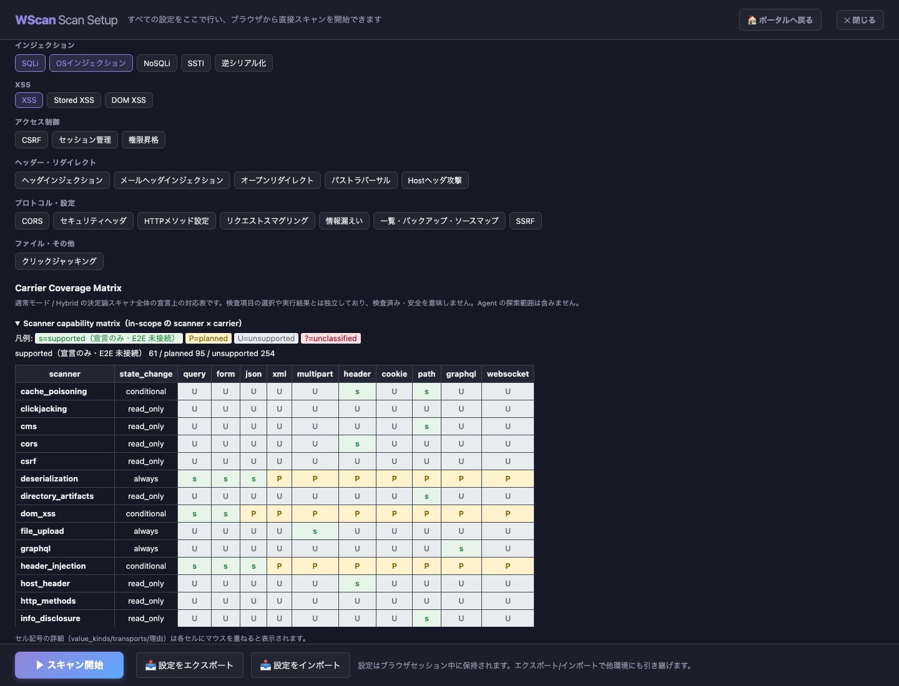

### Evidence completion

通常スキャンの結果では、スキャンのライフサイクル状態（`done` / `aborted`）や Finding 件数と、必須の検査判断が証跡として記録されたかを分けて表示します。`COMPLETE` は計画された単位の判断がすべて記録され実行も正常終了した状態、`PARTIAL` は判断の記録があっても timeout・blocked・skip などで実行が完了していない状態、`EVIDENCE_INCOMPLETE` は計画・検出器契約・証跡保存に不足がある状態です。

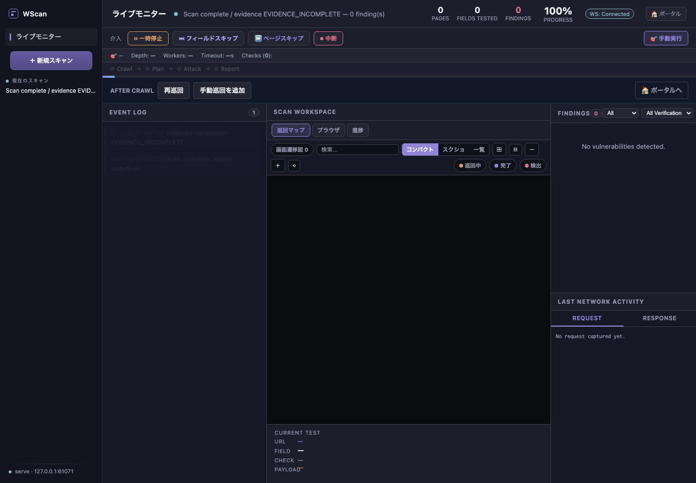

現在この完了ゲートが全判断を計測するのはページ単位の CORS 分析と Origin 比較、および CORS Finding の再検証です。他の detector、transport、補助経路は明示的に未完了として扱われます。詳細は [Evidence completion の仕様](evidence-completion.md) を参照してください。

### 基本設定

| 項目 | 内容 | 初回の目安 |
| --- | --- | --- |
| クロール深度 | 同一スコープ内を辿る深さ | `1` から開始 |
| タイムアウト | リクエスト/ページ待機秒 | 既定 `30` |
| 最大フォーム数/ページ | 1ページで検査するフォーム数 | 既定 `50`。対象に応じて縮小 |
| 並列ワーカー数 | 同時に攻撃するブラウザ数 | `1`。確認後に `2〜4` |
| ペイロード上限/フィールド | フィールド×チェックの標準投入上限 | `0` は無制限。初回は小さくしてもよい |
| リクエスト間隔 | リクエスト間の待機秒 | 既定 `0.5`。負荷を下げるなら増やす |
| ページ遷移リトライ | 一時的な遷移失敗の再試行回数 | 既定 `2` |
| レポート言語 | HTML・SARIF の出力文言を日本語 / English から選択 | 既定は日本語 |
| 検査時間帯 | 検査可能/停止時間帯を1行1件で指定。例: `Mon-Fri 22:00-06:00` | 任意。空欄なら無効 |
| Proxy | Burp Suite / mitmproxy 等 | 必要な場合のみ |
| TLS | mTLS、PFX、CA、検証。サーバー配備時はブラウザからアップロード可 | 必要な場合のみ |

### 設定タブ

「基本設定」の「レポート言語」は通常・Agent・Hybrid の生成レポートに共通です。設定 export/import とブラウザ保存にも含まれ、次回起動時の初期値は `config/wscan.yaml` の `output.language` で設定できます。CLI の補助入口では `scan` / `agent` / `batch` に `--report-lang en`（または `ja`）を指定します。Agent は HTML のみ、通常・Hybrid・batch は HTML 全テンプレートと SARIF に適用します。

日本語の既定表示は従来の英語ラベルを含む文言を維持します。証拠・URL・ペイロード・識別子と LLM が生成した解析/修正案は原文を保持し、検出結果・確度は言語に影響されません。英語の静的修正案は簡潔なガイダンスです。レポート選択は生成時に適用され、過去のファイルの言語は変更しません。

| タブ | 主な用途 |
| --- | --- |
| 基本設定 | Depth、Timeout、Forms、並列、負荷、Proxy、TLS、Headless |
| 検査項目 | XSS、SQLi、CSRF、CORS、SSRF、JWT、CMS などを選択 |
| 認証・Cookie | Cookie、自動ログイン、低権限 Cookie、ネイティブ TOTP、Bearer/カスタムヘッダ、複数アカウント |
| LLM設定 | provider、モデル、OpenAI互換 URL、役割別モデル |
| 機能フラグ | Planner、AI 分析、WAF、学習、community ペイロード、sitemap、SPA、巡回レビュー、状態変更プローブ許可 |
| スコープ・除外 | 攻撃対象、アクセスのみ、除外 URL、除外フィールド |
| 手動巡回 | 可視/遠隔ブラウザ、URL リストからシードを作成 |
| 攻撃フロー | ログイン、入力、クリック、待機など複数手順を定義 |
| Agent Browser | LLM 自律操作モード |
| ハイブリッド | Agent 偵察から通常スキャンへ引き渡すモード |

機能フラグの「SPA自動有効化（検出時）」は既定 ON です。初回ページに Angular / React / Next.js / Vue / Nuxt の固有マーカーがある場合だけ「SPA クロール」を自動で有効化し、通常層の確実性を保つため一般的なページ構成だけでは有効化しません。CLI の opt-out は `--no-auto-spa` です。「SPA クロール (React/Vue/Angular)」を明示的に ON にした場合は自動判定の設定より優先されます。

「状態変更プローブ許可」トグル（`allow_state_changing_probes`）は既定 OFF です。有効にすると、垂直・水平権限昇格検査における POST/PUT/PATCH 等のメソッド改ざんプローブや、SPA 自動クロール時のクリック探索および観測非GET body の注入再送を許可します。対象サーバの状態を変更する可能性があるため、変更を加えても安全なステージングやテスト環境などの検証環境に限定して有効化してください。CLI のオプションは `--allow-state-changing-probes` です。

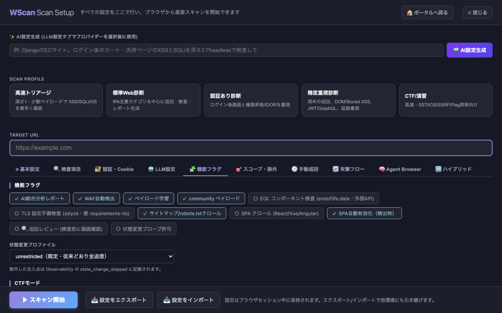

「機能」タブの「状態変更プロファイル」は注入フォームの送信方針です。既定の `unrestricted` は従来どおり POST を含む全フォームを検査します。`controlled-write` は delete/remove/purchase/pay/transfer/send/logout などの破壊語を action・ボタン・URL に含む書込みを除外し、通常の POST 注入は続けます。`read-only` は POST/PUT/PATCH/DELETE を送信せず GET/URL パラメータだけを検査します。除外は Event/レポートの Observability に `state_change_skipped` として残るため、通常層の確実性を判断するときは未送信件数も確認してください。

SPA クロールでは、(1) `history.pushState`/`replaceState` をフックし、ナビゲーション要素（nav リンク・タブ・`data-route` ボタンなど）をクリックして仮想ルートを発見しクロール対象に追加、(2) 描画確定待ち（`networkidle` 上限付き＋ルート要素の描画完了）で `<app-root>` が空のまま抽出されるのを防止、(3) 描画中に観測した攻撃スコープ内の GET API/XHR エンドポイント（クエリ付き。例: `/rest/products/search?q=`）を攻撃対象へ自動追加し URL パラメータとして注入検査、を行います。通常のリンクだけでは辿れない SPA でも検査対象が広がります。

### 認証とスコープ

認証が必要なら「認証・Cookie」で Cookie、ログイン URL、入力欄名、ユーザー名、パスワード、成功判定文字列を設定します。ログイン成否は URL 変化だけでなく、ログインフォームの残存、失敗メッセージ、MFA 画面の残留も使って判定します。

- 「攻撃対象」: 巡回もペイロード投入も許可する範囲。
- 「アクセスのみ許可」: 外部 IdP やログイン補助など、到達は必要だが攻撃しない範囲。
- 「除外」: ログアウト、削除、決済、通知送信などを避ける範囲。

通常ツール層（`scan`）の TOTP は、`otpauth://` URI、Base32 シークレット、QR 画像からローカル生成できます。メールや従来の MCP 方式も利用できます。Bearer トークンまたは1行1件のカスタムヘッダは通常スキャンの crawl と全 HTTP リクエストに加え、Agent と Hybrid Phase 1 の Agent 偵察にも付きます。Hybrid Phase 2 も同じ実効ヘッダを使います。`Authorization` をカスタムヘッダで明示した場合は Bearer 欄より優先されます。TOTP URI/シークレットと Bearer は実行時だけ使われ、設定 export やブラウザ保存には含まれません。詳しくは [README の MFA](../README.md#13-認証mfaスコープtls) を参照してください。

QR画像を選ぶと TOTP 登録情報として確認し、発行者・アカウント・桁数・周期を表示します。成功すると Base32 シークレット欄（マスク表示）と生成条件に自動反映されます。読取用画像は保存せず、設定 export にシークレットを含めません。壊れた画像、TOTP 以外の QR、デコーダ未導入は理由を表示します。確認中・失敗後は画像の再選択、または URI / Base32 / サーバ側パスの入力が必要です。MFAを使わない場合は「無効」に切り替えられます。

入力欄の name/id が分からなくても自動検出を試します。「OTP入力欄の CSS selector」は自動検出より優先されます。手動で指定する場合は「手動巡回」の遠隔ブラウザで OTP 画面まで進み、「OTP欄を指定」を押して入力欄をクリックすると認証設定へ反映されます。TOTP を設定済みなら選択時に現在コードを自動入力し、「TOTPを再入力」で期限切れ後のコードを再生成できます。コード自体は API 応答や履歴へ出しません。指定が一意でない・非表示などの場合は別の欄へ入力せず失敗として扱います。新規タブや popup が開いた場合は遠隔画面と入力対象が新しいページへ切り替わり、閉じると残存する最新タブへ戻ります。

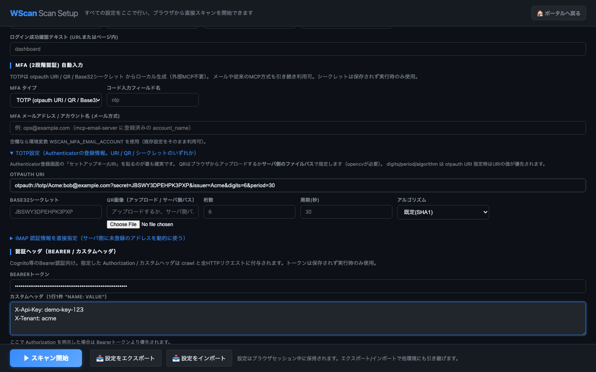

### Proxy と TLS

Burp Suite 等で通信を見る場合:

```text
http://127.0.0.1:8080
```

mTLS では PEM のクライアント証明書/秘密鍵、または Playwright 用 PFX/PKCS#12 を指定します。CA バンドルと「TLS証明書を検証」は httpx の直接リクエストに使われます。Playwright 側は HTTPS エラーを許容しながらクライアント証明書を提示します。

### サーバー配備時のファイルアップロード

リモートのダッシュボードでは、次の入力をブラウザからアップロードしてサーバー側パス欄へ自動反映できます。

- TLS クライアント証明書、秘密鍵、PFX/PKCS#12、CA バンドル
- カスタムペイロードファイル
- 手動巡回 JSON（通常設定と巡回レビュー）

ファイルは `output/uploads/` に保存され、1ファイル 8MBまでです。拡張子は入力用途に応じた許可リストで制限されます。既存のサーバー側パス手入力も利用できます。`output_dir` と手動巡回の保存先は出力先なのでアップロード対象ではなく、リモート配備では空欄（自動）を推奨します。

## 6. Agent / Hybrid タブを設定する

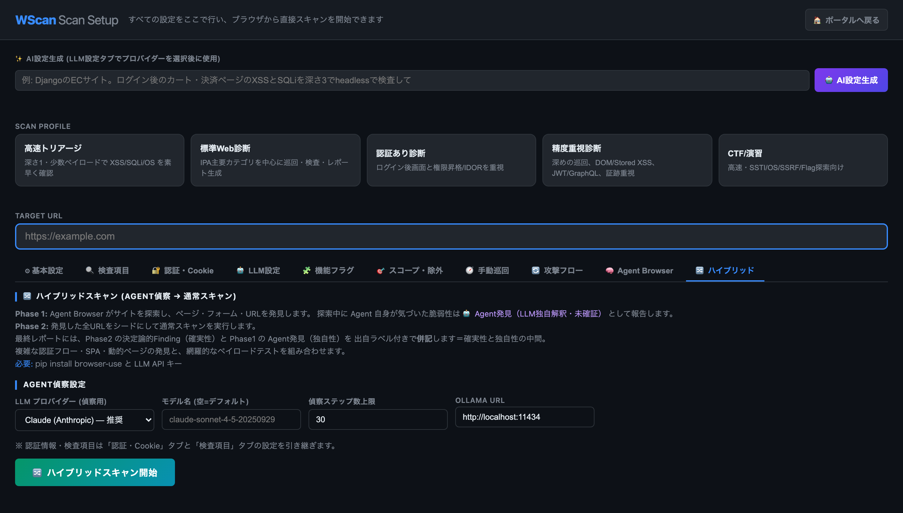

### Agent Browser

「Agent Browser」タブでは次を設定します。

- LLM provider: Claude / OpenAI / Ollama
- モデル名: 空なら provider 既定
- 最大ステップ数: 既定 `100`
- 検査項目: Agent 対応種別から選択
- ログイン URL、ユーザー名、パスワード

Bearer/カスタムヘッダは「認証・Cookie」の設定を引き継ぎます。「Agent Browser スキャン開始」を押すと、LLM がブラウザを観察し、ページ遷移、入力、ペイロード選択、結果判断を自律的に行います。Agent の独自性を残す設計のため、Finding は未確証でもレポートへ残ります。

### Hybrid

「ハイブリッド」タブでは、偵察用 provider、モデル、最大ステップ数（既定 `30`）、Ollama URL を設定します。ログイン情報、Bearer/カスタムヘッダとチェック種別は「認証・Cookie」「検査項目」の設定を引き継ぎます。

Hybrid の処理:

```text
Phase 1: Agent が探索
  ├─ 発見した URL
  └─ Agent Finding（脆弱性仮説）
              ↓
Phase 2: 発見 URL をシードに通常スキャン
              ↓
最終レポート: 決定論 Finding + Agent Finding をラベル付きで併記
```

Agent Finding は `🤖 Agent発見（LLM独自解釈・未確証）` として表示されます。決定論的な再現確認が付いた Agent Finding は、さらに `✅ 決定論的にも再現確認済み` と表示されます。Hybrid は Agent を偵察だけに使うモードではありません。

## 7. スキャンを開始する

### 通常モード

画面下部の「スキャン開始」を押します。Planner の対話確認を有効にしている場合は、巡回後に検査対象フィールド、チェック、カスタムペイロードを確認し、「攻撃開始」を押します。

巡回レビューを有効にしている場合は、画面遷移図を確認し、そのまま検査、再巡回、URL追加、手動巡回追加、シナリオ作成を選べます。

### Agent / Hybrid

各タブ内の専用開始ボタンを押します。通常設定画面下部の「スキャン開始」は通常モードの入口なので、モードを間違えないよう注意してください。

## 8. 実行中の状態を確認する

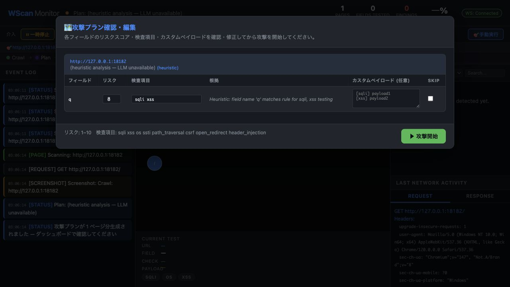

通常スキャンの主なフェーズは次のとおりです。

```text
Crawl -> Plan -> Attack -> Report
```

画面では次を確認できます。

| 場所 | 内容 |
| --- | --- |
| ヘッダー | フェーズ、進捗率、残り推定、完了予定、Finding 件数（確証件数と未確証件数） |
| 巡回マップ | 発見ページ、巡回中/完了/検出状態 |
| ブラウザ | 実行中のスクリーンショット |
| 進捗 | チェック種別ごとの進行状況 |
| Current Test | URL、Field、Check、Payload |
| Findings | 重要度、種別、URL、Evidence。全件数バッジと未確証件数バッジ、重要度・確証状態・文字列で絞り込み |
| Request / Response | 直近の通信 |
| Event Log | 認証、再試行、LLM、エラー、フェーズ変更 |

上部の介入バーから、一時停止、再開、現在フィールドのスキップ、現在ページのスキップ、中断、手動ペイロード実行を行えます。中断を確定すると、停止が終わるまでヘッダーに「中断処理中...」と表示されます。中断後はヘッダーの終端状態が「中断」となり、進捗欄にも中断が表示されます。通常完了とは区別され、その時点までに得られた Finding を含む部分レポートが保存されます。

進捗率は攻撃フェーズの進行を表します。Finding の再検証中は進捗バーを書き換えず、ヘッダーのステータス文に「検証 i/n」と表示します。正常完了すると進捗率は 100% になります。

Finding 件数は次のように読みます（通常・Agent・Hybrid 共通）。

- ヘッダーの Findings: 未確証が無いときは全件数。未確証があるときは確証件数を表示し、横に `(N hyp)` で未確証件数を添えます。
- Findings パネルのバッジ: 全件数と、未確証があるときだけ `N hyp` を表示します。
- 確証 (Confirmed) は `verification_state=reproduced` の Finding です。`assumed` などの未検証・非再現や、Agent の未確証 Finding は未確証 (Hypothesis) に数えます。再検証で状態が変わると件数も更新されます。
- 「All Verification」で Confirmed / Hypothesis に絞り込めます。重要度・文字列の絞り込みと組み合わせられます。

Finding が 0 件のときの表示も区別します。中断した場合は「スキャンは中断されました」と部分結果であることを示します。一部の対象や入力が未検査（エラーや除外）の場合は、未検査件数を注意書きで添えます。0 件は「安全」とは限りません。

再接続やページ再読み込み後も、件数・終端状態・未検査件数はサーバーの状態から復元します。

完了・中断後は結果画面を保持します。次のスキャンは「＋ 新規スキャン」から設定できます。

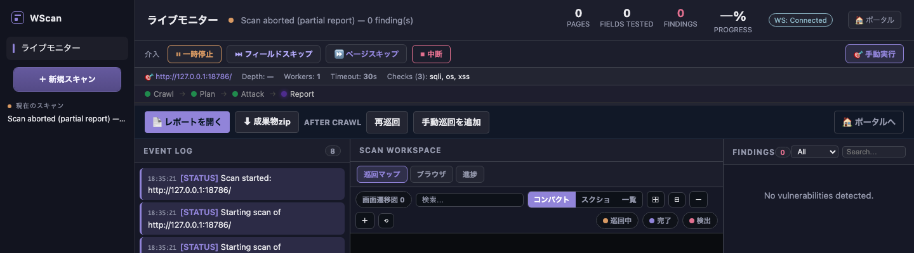

Hybrid では Event Log に Phase 1 の URL 数と Agent Finding 数、Phase 2 の開始が表示されます。Phase 1 が失敗した場合は警告を出し、URL シードと Agent Finding なしで通常スキャンを続行します。

## 9. 結果と Finding を読む

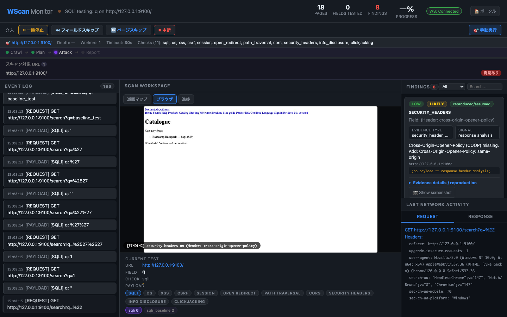

Finding では、重要度だけでなく確証と出自を確認します。

| 項目 | 確認内容 |
| --- | --- |
| Severity | Critical / High / Medium / Low / Info。対応優先度の目安 |
| Type | XSS、SQLi、CSRF などの検査種別 |
| URL / Field | どのページ、パラメータ、入力欄、ヘッダか |
| Evidence | alert 発火、レスポンス差分、エラー、ヘッダ等 |
| Request / Response | 実際の投入と応答 |
| `verified` | `verification_state` から派生する読み取り専用値。`reproduced` のときだけ `true` |
| `verification_state` | `reproduced`（再現済み）/ `assumed`（推定・再検証未実行）/ `unreproduced`（非再現）/ `skipped`（検証 skip）。空は旧 Finding |
| `confidence` | `confirmed` / `likely` / `tentative` |
| `evidence_type` | 判定に使った構造化シグナル |
| `source` | `scanner`（通常）/ `agent`（Agent） |
| `agent_verified` | Agent Finding を決定論的にも再現したか |

HTML レポートのバッジ:

- `🤖 Agent発見（LLM独自解釈・未確証）`: Agent の仮説。人手で証拠と再現手順を確認する。
- `✅ 決定論的にも再現確認済み`: Agent Finding に決定論的確認が付いている。
- `〜 推定（再検証未実行）`: 通常 Finding を検証できなかったため保持している。再現済みではない。
- `⚠ 要確認`: 2回目に再現しなかったか、例外で検証を skip した Finding。詳細は `verification_note` を確認する。
- バッジなし: 通常の決定論スキャナ由来。

`severity=critical` でも Agent 未確証なら確証済みとは扱いません。通常 Finding でも `verification_state=assumed`、`confidence=tentative`、`verified=false` の場合は追加確認が必要です。

通常層（確実性重視）の HTML レポートは、`verified=true` を **確証 (confirmed)** として主件数・重大度別件数に数え、それ以外を **未確証 (hypothesis)** として別表示します。未確証も Finding 一覧から削除されず、Evidence と再現情報を確認できます。SARIF でも全 result を保持しますが、未確証の `level` は `note` です。

## 10. レポートと証跡を確認する

完了後、ポータルの履歴から HTML、JSON、ダウンロードを開けます。ファイルは `output/<日時>/` に保存されます。

| ファイル | 内容 |
| --- | --- |
| `report.html` | Finding、Evidence、Agent バッジ、カバレッジ表、観測性メトリクスを含む HTML |
| `report_executive.html` | 管理層向けサマリー |
| `report_developer.html` | 開発者向け詳細 |
| `evidence.json` | Finding と証跡 JSON |
| `reproduction.json`, `reproduce.sh` | 再現情報 |
| `report.sarif` | CI/CD 用 SARIF。全 Finding を保持し、未確証は `level: note` |
| `remediation_plan.md`, `remediation_tasks.json` | 修正計画とタスク |
| `http_requests.jsonl`, `payloads.jsonl` | 通信と投入ペイロードの監査ログ |
| `llm_calls.jsonl` | LLM 呼び出しの監査（provider/role/model/所要時間/失敗種別/文字数）。プロンプト・応答本文は保存しない |
| `scan_config.json` | 実行設定。秘匿値は伏字 |
| `checkpoint.json` | 再開用の完了単位と Finding |

HTML レポートと Evidence を確認し、必要なら再現物で人手検証してから修正タスク化します。

通常層（確実性重視）の HTML レポートでは、Observability の直後に Coverage（到達性カバレッジ）を表示します。到達/未到達 URL と理由、検査試行の状態別件数、HTTP 403/429 のブロック数を確認してください。0 findings でも、未到達やブロックがあれば攻撃面を十分に検査できていない可能性があります。

Coverage セクション内には「検査カバレッジ（in-scope の scanner）」に続けて、**実行条件が満たされない検査**の一覧が出ることがあります。選択されていても (a) 認証セッション・OOB 受信シンク・API 仕様シード・複数アカウントなどの前提が未設定、(b) `--state-profile read-only` で状態変更を伴う検査（mass_assignment・graphql・xxe 等）が送信 skip、のいずれかに該当する検査は実質的に検査できていない可能性があるため、検査名・種別（前提不足／state profile）・理由を表示します。ここに検査が挙がっている場合、Findings が 0 でも「安全」とは限りません。`--no-monitor` やバッチ実行で HTML を開かない場合も、スキャン終了時の console 要約行に前提不足（`unmet-prereq N`）と state profile skip（`profile-skipped N`）の件数が併記されるため、CI ログからも未検査範囲を把握できます。

続けて折りたたみ式の **Scanner capability matrix**（今回実行対象の scanner × 入力経路 carrier）を表示します。各セルの記号（`s`=supported（宣言のみ・E2E 未接続）/`P`=planned/`U`=unsupported/`?`=未分類）で「その検査がどの経路を突けるか」が分かり、未実装セルは色分けされます。`s` は capability を宣言していることを示すだけで、その carrier を実際に突いた（E2E 検証済み）という意味ではない点に注意してください。セルにマウスを重ねると value kind・transport・未対応理由が表示され、「なぜこの経路を検査できなかったか」を確認できます。全 scanner 分の一覧が必要なときは CLI の `capability-matrix` サブコマンドを使ってください。

## 11. 長時間スキャンと再開

通常スキャンはチェックポイントを既定で保存します。ブラウザ停止、ネットワーク断、時間帯待機、中断後は CLI で再開できます。

```bash
python3 main.py scan https://example.com \
  --resume output/20260721_010203
```

通常攻撃の例外終了単位と、adaptive LLM の一時失敗は未完了として残ります。adaptive はチェック種別単位で完了を記録するため、成功済みチェックを繰り返さず、失敗分だけを回収します。provider 自体が恒久的に不達の場合は決定論 fallback で完了し、resume の無限再試行を避けます。

ダッシュボードから開始したスキャンの `checkpoint.json` も同じ出力ディレクトリに保存されます。再開は現時点では CLI の `--resume` を使用します。

## 12. スキャン履歴の確認と成果物ダウンロード

左側サイドバー（レイル）の「スキャン履歴」を選択すると、サーバー上で保持されている過去のスキャン実行履歴一覧が表示されます。

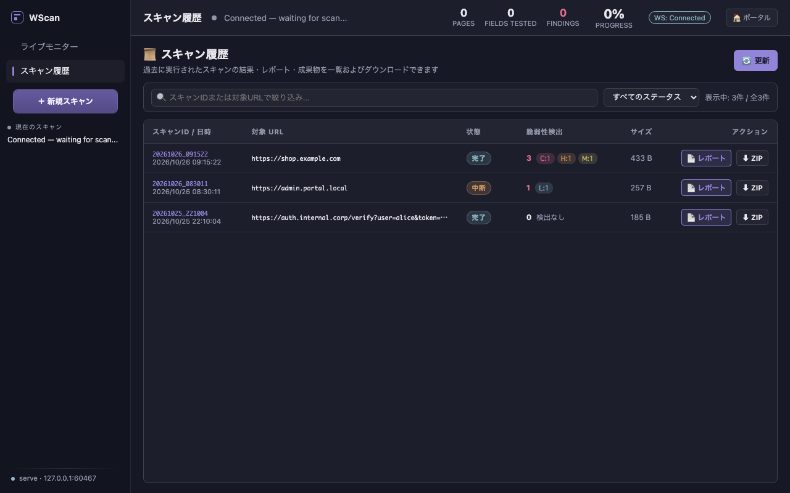

- **状態の確認**: `完了 (done)`、`中断 (aborted)`、`実行中 (scanning)`、`未完了 (incomplete)`、`エラー (error)` が視覚的バッジで表示されます。
- **検出サマリー**: 検出件数と重大度内訳（Critical / High / Medium / Low）を一覧で確認できます。
- **成果物リンク**: 各行から直接 `📄 レポート` をブラウザで開いたり、`⬇ ZIP` をクリックして該当スキャンの成果物一式（レポート・エビデンス・ログ）をダウンロードできます。
- **検索と絞り込み**: 対象 URL やスキャン ID でのテキスト絞り込み、およびステータス別フィルタリングが利用可能です。
- **URL の表示保護**: 対象 URL は表示時だけ資格情報（userinfo / 機密 query・fragment / matrix・セッション系パス）を伏せます。HTTP(S) として解釈できない値は生文字列を出さず中立のプレースホルダで表示します。保存済みのスキャン設定や成果物は変更しません。
- **検出件数の確度**: evidence が欠落・破損・読取不能な履歴は件数を「未取得」と表示します。「検出なし」は、完了を裏づける有効な evidence が明示的に 0 件のときだけ表示します。
- **画面切り替えの保持**: 「ライブモニター」と「スキャン履歴」を行き来しても、バックグラウンドでの WebSocket イベント受信や進行中スキャンの状態は破棄されず安全に維持されます。

## 13. 監査ログの確認とセキュリティ保護

左側サイドバー（レイル）の「監査ログ」またはモバイルヘッダーの「監査」を選択すると、サーバー上で記録された管理操作の監査ログ（最新200件）を閲覧できます。

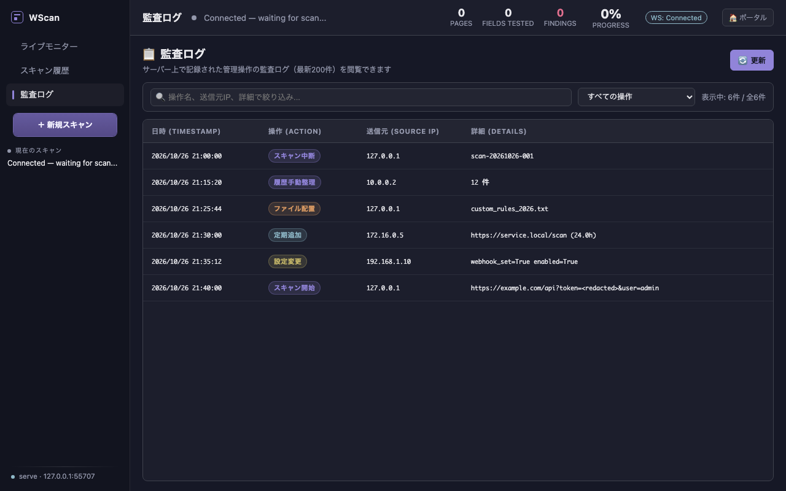

- **記録される管理操作**: スキャン開始/中断/削除、履歴手動整理、定期スキャンの登録/切替/削除、ファイル配置、通知設定変更などが記録されます。
- **操作種別の固定バッジ**: 既知の管理操作は固定の日本語ラベル（`スキャン開始`、`スキャン中断`、`設定変更` など）のバッジで表示されます。未知・未定義の操作は `その他操作` として中立表示します。
- **日時の厳格検証**: ISO 形式として妥当な日時のみを現地時間で整形表示し、無効・不正な形式は `不明` と表示して改ざんや誤認を防ぎます。
- **送信元 IP の厳格検証**: 正当な IPv4 / IPv6 アドレスのみを表示し、不正な文字やプロキシヘッダ混入によるインジェクション・生文字列は `—` としてマスクします。
- **詳細情報のプライバシー保護**:
  - 全ての任意詳細（URL、ファイル名、スキャンID、設定値など）は、内容や形式を問わず一律で固定の `（詳細非表示）`（空値の場合は `（詳細なし）`）として安全に秘匿表示します。
  - 監査ログの raw ファイル（`output/management_audit.jsonl`）や backend API の保存契約は一切変更せず、表示層での安全性を担保します。
- **検索と絞り込み**: 操作グループ別（スキャン / 定期スキャン / ファイル配置 / 設定変更 / その他）のドロップダウン絞り込み、およびテキスト検索に対応しています。
- **状態ハンドリング**: 読み込み中スピナー、空状態（「記録された管理操作はありません」）、401 認証エラー時の再試行ボタンを完備しています。
- **画面切り替えの非破壊性**: ライブモニター、スキャン履歴、監査ログ間を切り替えても、バックグラウンドの WebSocket 接続やライブ状態は維持されます。

## 14. よくあるつまずき

### 対象にアクセスできない

ブラウザから Target URL を開けるか、VPN、DNS、IP 制限、Proxy、mTLS、CA を確認します。Event Log と `http_requests.jsonl` も確認してください。

### ログイン後の画面を検査できない

Cookie、ログイン URL、入力欄名、成功判定文字列、MFA を確認します。セッションが短い場合は Event Log の `Session expired` と再ログイン結果を確認し、認証済みページに必ず出る文字列を CLI の `--logged-in-marker` で補強できます。

### SPA のページが足りない

「精度重視診断」または SPA Crawl を有効にし、手動巡回、遠隔ブラウザ、URL リスト、HAR、OpenAPI/Postman でシードを補います。

### 検出が少ない

チェック種別、Depth、Max Forms、ペイロード上限、除外、認証スコープを確認します。高速プロファイルは網羅性より時間を優先します。

### Agent / Hybrid が動かない

`requirements-agent.txt`、API キー、モデル名、Ollama URL を確認します。ダッシュボードの Agent/Hybrid provider は Claude、OpenAI、Ollama です。Gemini を使う場合は通常スキャンの LLM 設定を使用してください。

### LLM の一時失敗がある

`config/wscan.yaml` の `llm.timeout_seconds` と `llm.max_retries` を調整します。通常スキャンは fallback で継続します。adaptive の未完了分は `--resume` で回収します。

### 対象への負荷を下げたい

Depth、Max Forms、ペイロード上限、並列数を下げ、リクエスト間隔を増やします。状態変更プローブは有効にしないでください。

詳細な切り分けは [トラブルシューティング](troubleshooting_ja.md)、実検査前の準備は [運用ガイド](operation_guide_ja.md) を参照してください。

## 15. 最短手順まとめ

```bash
python3 main.py serve --host 127.0.0.1 --port 8765
```

1. `http://localhost:8765/` を開き、「新規スキャン」を押す。
2. Target URL とプロファイルを指定する。
3. 認証、スコープ、検査項目、負荷を確認する。
4. 通常は画面下部、Agent/Hybrid は各タブ内の開始ボタンを押す。
5. 実行中は Event Log、Current Test、Request/Response、Findings を確認する。
6. 完了後は Agent バッジ、Evidence、再現物、HTML/JSON/SARIF を確認する。
